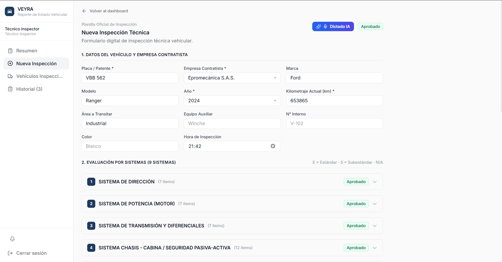
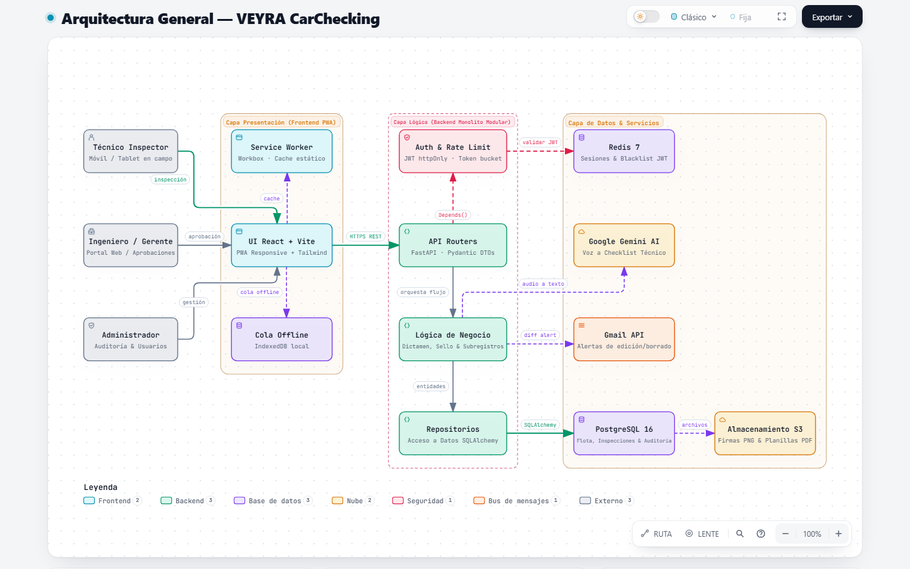
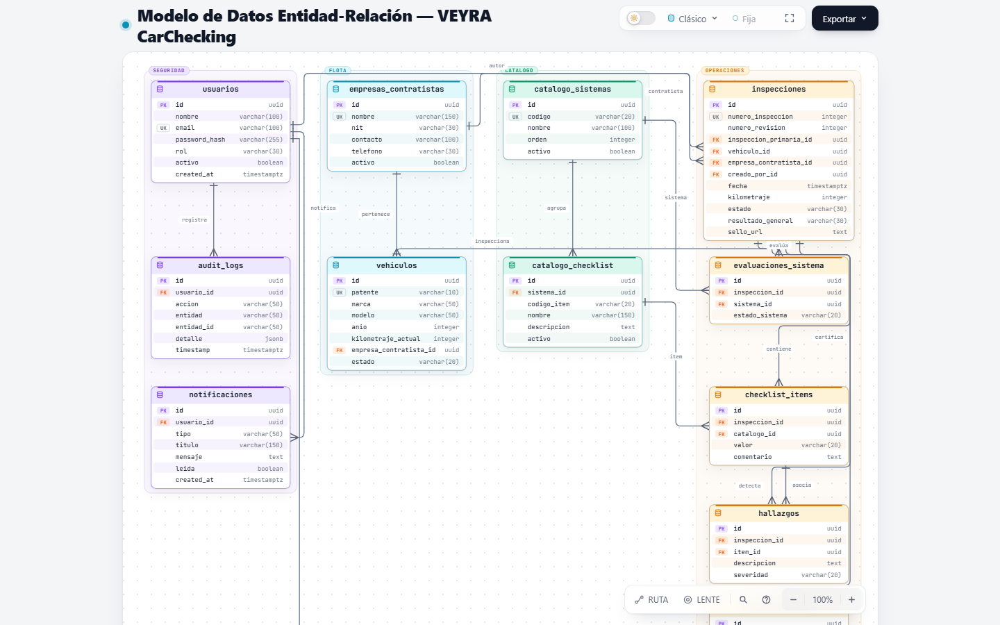
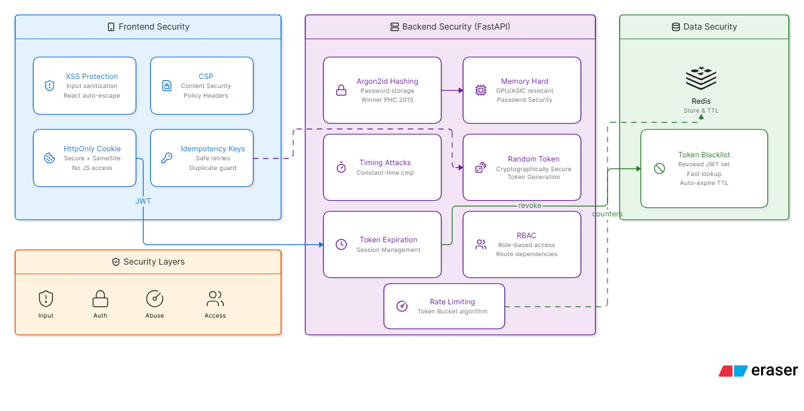
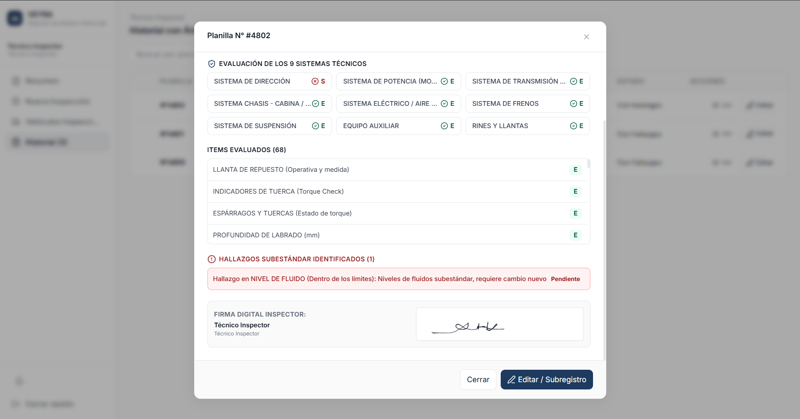
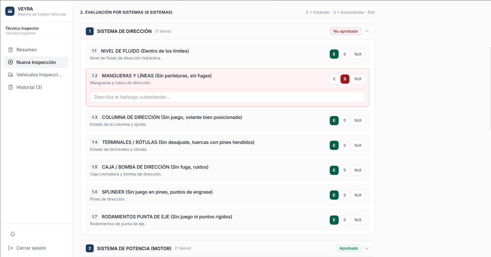

# VEYRA — Reporte de Estado Vehicular para Interventoras

VEYRA es una **Progressive Web App (PWA)** diseñada para optimizar y digitalizar los flujos de trabajo de inspección técnica vehicular en terreno para interventoras y contratistas. Su formato PWA facilita la instalación y uso sin fricciones, brindando una experiencia rápida, confiable y con soporte **offline-first** tanto en dispositivos móviles en campo como en terminales de escritorio para supervisión.

El objetivo principal es reemplazar las planillas físicas (`FO-M4-P13-96`) por un flujo digital estandarizado, reduciendo tiempos de captura, eliminando errores de transcripción y garantizando **trazabilidad e inmutabilidad histórica** en todo el ciclo de inspección técnica de la flota.

---

## 🛠️ Stack Tecnológico

El sistema fue concebido como un monolito modular moderno, priorizando velocidad de desarrollo, seguridad de grado corporativo y bajo costo operacional.

> **Diagrama del Stack Tecnológico**
>
> 
>
> 🔗 *[Ver Diagrama Interactivo del Stack Tecnológico](.archify/tree-tech-stack-20261014-120700/tech-stack.html)*

* **Frontend (PWA)**:
  * **React 18 & TypeScript**: Componentes declarativos y tipado estático estricto.
  * **Vite**: Servidor de desarrollo con HMR instantáneo y empaquetado optimizado.
  * **TailwindCSS + Lucide Icons**: Diseño responsive y accesible adaptado a tablets y teléfonos de campo.
  * **Service Worker & Workbox**: Caché de recursos estáticos e instalabilidad como aplicación nativa.
  * **IndexedDB**: Cola local de almacenamiento para operación continua sin conexión a internet.
* **Backend (Core API)**:
  * **FastAPI + Uvicorn**: Framework web ASGI asíncrono de alto rendimiento con validación automática y OpenAPI.
  * **Pydantic v2**: Serialización y validación estricta de esquemas y DTOs de entrada/salida.
  * **uv**: Gestor de dependencias y entornos virtuales de última generación para Python.
  * **Argon2id + PyJWT**: Criptografía avanzada para contraseñas y tokens JWT en cookies `httpOnly + Secure + SameSite=Strict`.
  * **OpenPyXL**: Generación automatizada de reportes y planillas en formato Excel.
* **Persistencia y Caché**:
  * **PostgreSQL 16**: Base de datos relacional transaccional (ACID) como única fuente de verdad.
  * **SQLAlchemy 2.0**: ORM moderno con mapeo declarativo y repositorios desacoplados.
  * **Alembic**: Control de versiones y migraciones reproducibles del esquema de datos.
  * **Redis 7**: Rate limiting con algoritmo token bucket, control de idempotencia y blacklist para revocación inmediata de sesiones.
* **Inteligencia Artificial y Servicios**:
  * **Google Gemini AI SDK**: Transcripción y estructuración inteligente de notas de voz técnicas en campo a campos del checklist.
  * **Gmail API (OAuth2)**: Notificaciones transaccionales seguras ante eventos críticos (edición o eliminación de reportes).
  * **Almacenamiento S3**: Custodia de firmas digitales táctiles y documentos generados.
* **Infraestructura y DevOps**:
  * **Docker & Docker Compose**: Orquestación reproducible de servicios para desarrollo y producción.
  * **Git / GitHub**: Trazabilidad completa del código fuente y versionamiento de artefactos.

---

## 🏛️ Arquitectura del Sistema

La aplicación sigue una **arquitectura monolítica en capas** bajo el patrón **MVC / Routers-Services-Repositories**.

Se seleccionó un monolito modular porque simplifica el despliegue, elimina la sobrecarga operativa y de red de los microservicios en esta etapa, y mantiene una clara separación de responsabilidades que permite escalar horizontalmente componentes específicos si la operación lo demanda.

> **Diagrama de Arquitectura General**
>
> 
>
> 🔗 *[Ver Diagrama Interactivo de Arquitectura General](.archify/architecture-carchecking-general-20261014-120700/carchecking-general.html)*

### Separación de Responsabilidades:
1. **Capa de Presentación (Frontend PWA)**: Manejo de estado local, captura táctil de firmas, formularios reactivos y motor de sincronización offline con reintentos automáticos.
2. **Capa API (FastAPI Routers)**: Definición de endpoints HTTP REST, validación sintáctica mediante esquemas Pydantic e inyección de dependencias (`Depends()`). No contiene lógica de negocio.
3. **Capa de Dependencias y Seguridad**: Autenticación transversal, verificación de permisos RBAC por rol (`tecnico_inspector`, `ingeniero`, `programador`, `administrador`), verificación de blacklist en Redis y control de cuotas.
4. **Capa de Negocio (Services)**: Lógica pura del dominio vehicular: cálculo automático del dictamen general de los 9 sistemas técnicos, validación de kilometraje, y aplicación de la **Regla de Inmutabilidad** (las modificaciones crean un subregistro enlazado con motivo y fecha Colombia sin sobrescribir el historial).
5. **Capa de Datos (Repositories)**: Encapsulamiento de queries SQLAlchemy y operaciones transaccionales aisladas de la lógica de negocio.
6. **Capa de Persistencia**: PostgreSQL para datos relacionales y auditoría con diffs en JSONB; Redis para memoria rápida y sesiones.

---

## 🗄️ Modelo de Datos (Base de Datos)

El modelo relacional está diseñado para garantizar integridad referencial, trazabilidad jurídica y auditoría total de cada acción realizada.

> **Diagrama Entidad-Relación (ERD)**
>
> 
>
> 🔗 *[Ver Diagrama Interactivo de Base de Datos (ERD)](.archify/erd-base-de-datos-20261014-120700/base-de-datos.html)*

### Dominios del Esquema:
* **Seguridad y Auditoría**:
  * `usuarios`: Gestión de identidades, roles tipados y hashes criptográficos Argon2id.
  * `audit_logs`: Trazabilidad completa con deltas (diffs antes/después) en formato `JSONB`, IP y marca de tiempo.
  * `notificaciones`: Mensajería interna y estado de lectura para eventos del sistema.
* **Flota y Contratistas**:
  * `empresas_contratistas`: Registro y estado de empresas vinculadas al contrato de interventoría.
  * `vehiculos`: Hoja de vida del vehículo (patente colombiana `ABC 123`, marca, modelo, año y kilometraje actual).
* **Catálogo Normalizado**:
  * `catalogo_sistemas`: Definición oficial de los 9 sistemas técnicos inspeccionados (motor, frenos, eléctrico, carrocería, etc.).
  * `catalogo_checklist`: Ítems de inspección específicos parametrizados por sistema.
* **Operaciones e Inspección**:
  * `inspecciones`: Tabla central inmutable. Soporta autoreferencia (`inspeccion_primaria_id`) para encadenar subregistros históricos de reinspección.
  * `evaluaciones_sistema`: Dictamen consolidado (aprobado / no aprobado) por cada uno de los sistemas evaluados.
  * `checklist_items`: Respuestas granulares (estándar, subestándar, n/a) con comentarios técnicos.
  * `hallazgos`: Registro individualizado de anomalías subestándar para seguimiento y corrección.
  * `firmas_tecnicos`: Custodia y metadatos de las firmas digitales del técnico responsable.

---

## 🔒 Seguridad

Dado que la plataforma gestiona información sensible de vehículos, contratistas y personal de campo, la seguridad se implementó desde el diseño (*Security by Design*):

- **Autenticación y Autorización**: Control de acceso basado en roles (RBAC) validado en backend con `Depends(require_role)`.
- **Almacenamiento de Credenciales**: Hashing con **Argon2id** (memory-hard, resistente a ataques por fuerza bruta y canal lateral).
- **Protección contra Robo de Tokens**: Sesiones mediante cookies seguras con directivas `httpOnly`, `Secure` y `SameSite=Strict`.
- **Cierre de Sesión Efectivo**: Blacklist de tokens activos en Redis con expiración por inactividad y expiración absoluta.
- **Prevención de Inyección SQL**: Acceso exclusivo mediante SQLAlchemy ORM con sentencias parametrizadas.
- **Mitigación de Fuerza Bruta y DoS**: Rate limiting con algoritmo token bucket respaldado en Redis por IP y usuario.
- **Idempotencia**: Protección contra envíos duplicados en redes inestables mediante cabeceras `Idempotency-Key`.
- **Principio de Menor Privilegio (PoLP)**: Aislamiento de variables de entorno y ejecución sin privilegios de superusuario.

> **Diagrama de Seguridad**
>
> 

---

## 📱 Vista Previa de la Aplicación

> **Inicio de Sesión (PWA Mobile)**
>
> 

---

> **Panel de Control (Dashboard Desktop)**
>
> 